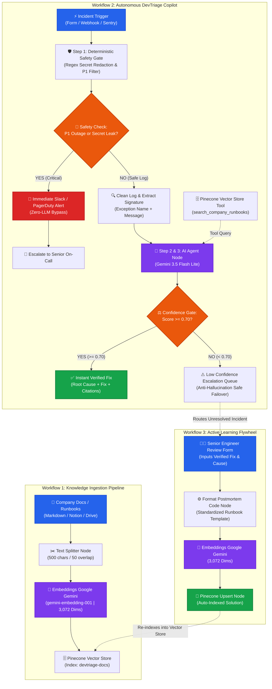

# DevTriage AI — Architecture Blueprint

> **Autonomous, Confidence-Gated Incident Triage Copilot with Active Learning Flywheel**
> *Engineered in n8n with Pinecone Vector DB & Google Gemini 3.5 Flash Lite*

---

## 🏛️ System Architecture Diagram

---

## ⚙️ The 4 Core Architectural Pillars

### 1. Zero-LLM Deterministic Safety Gate
- Runs prior to any AI model interaction.
- Uses compiled regex expressions to detect 700+ secret token patterns (OpenAI/Anthropic keys, AWS Access Keys, Bearer Tokens, Database credentials).
- Intercepts P1 critical outage keywords (`OutOfMemoryError`, `DatabaseConnectionPoolExhausted`, `FATAL_CRASH`, `SIGSEGV`).
- **Result:** Critical incidents bypass AI for sub-second on-call escalation; credentials are unconditionally sanitized (`[REDACTED_SECRET]`).

### 2. High-Dimensional Hybrid RAG (Pinecone + Gemini)
- Stored across 3,072-dimensional dense vector embeddings generated by Google Gemini.
- Embeds both standard company runbooks (Stripe, PostgreSQL, Redis) and human-verified postmortems.
- Allows the AI Agent to perform semantic lookup and exact error code alignment.

### 3. Anti-Hallucination & Mathematical Confidence Gate ($\ge 0.70$)
- AI Agent powered by **Gemini 3.5 Flash Lite** with strict grounding rules.
- Must cite internal runbook titles to justify confidence.
- If documentation does not cover the incident, the model strictly outputs confidence `< 0.50` (verified at 25%).
- High-confidence ($\ge 0.70$) outputs instant resolution; low-confidence fails over safely to human engineers.

### 4. Active Learning Flywheel (Continuous Learning without Retraining)
- When a human engineer reviews an escalated incident, the resolution pipeline structures the postmortem and upserts it directly into Pinecone.
- On recurring occurrences of the error, triage confidence rises from 25% to 95%, achieving autonomous resolution.
