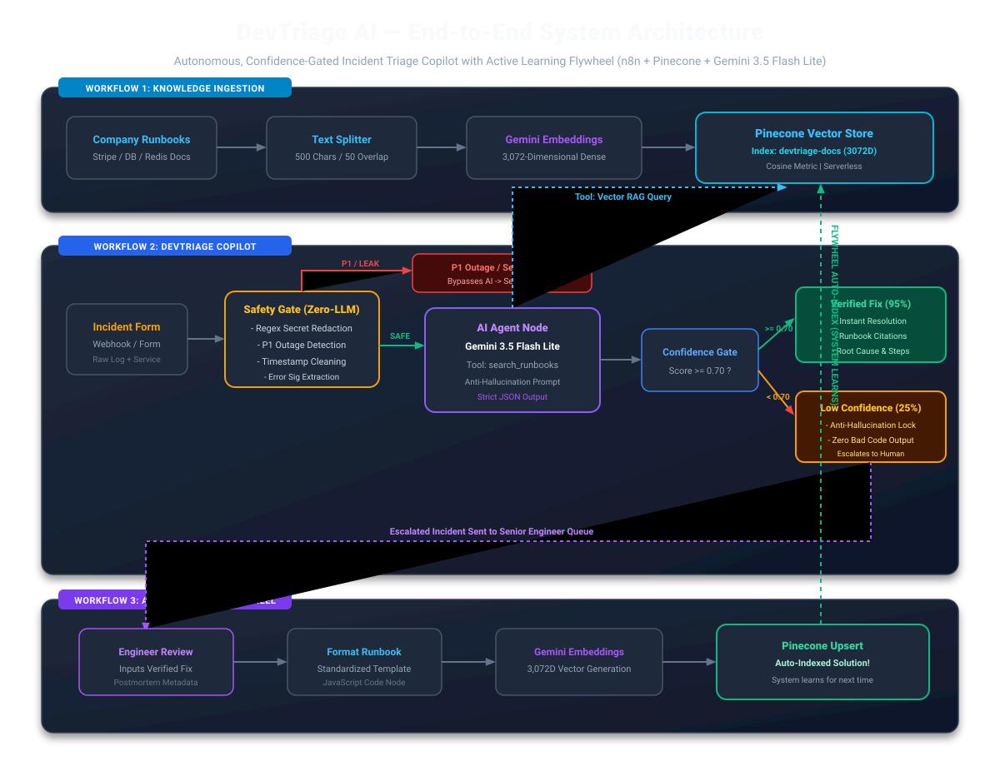
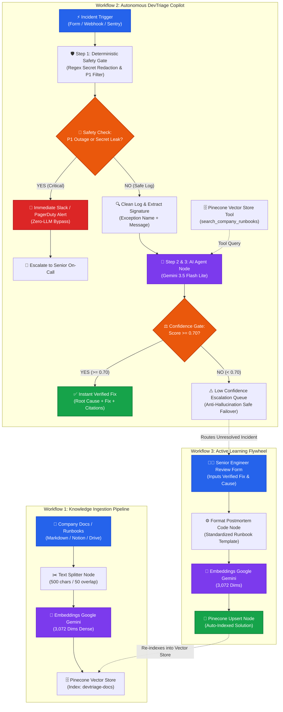

# ⚡ DevTriage AI — Autonomous Incident Triage Copilot

<p align="center">
  
  
  
  
  
  
</p>

---

## 📌 Executive Summary

**DevTriage AI** is an autonomous, confidence-gated incident triage copilot built natively inside **n8n**. It ingests raw developer error logs and stack traces, sanitizes credentials deterministically, cross-checks incidents against internal company runbooks via high-dimensional vector search, and either provides a **verified code fix with citations** or **safely escalates to senior human engineers**.

Crucially, DevTriage features an **Active Learning Flywheel**: when a senior engineer resolves an escalated incident, the postmortem is automatically vectorized and indexed into **Pinecone** in real time—enabling the system to autonomously resolve the same error on future occurrences with **95%+ confidence** without any model fine-tuning.

---

## 🏛️ System Architecture

<p align="center">
  
</p>

### End-to-End Workflow Diagram



---

## ⚙️ The 4 Core Architectural Pillars

### 1. 🛡️ Deterministic Safety Gate (Zero-LLM Risk)
* **Problem:** Sending raw developer error logs directly to an LLM risks leaking customer API keys, passwords, database URIs, and PII, violating SOC2 / HIPAA / GDPR compliance. Furthermore, slow LLM inference during P1 outages wastes critical incident response time.
* **DevTriage Solution:** A compiled JavaScript regex filter intercepts:
  * **Secrets & Credentials:** Intercepts OpenAI/Anthropic keys (`sk-[a-zA-Z0-9_\-]{20,}`), AWS Access Keys (`AKIA[0-9A-Z]{16}`), Bearer Tokens, and Database Connection URIs, replacing them with `[REDACTED_SECRET]`.
  * **P1 Outage Bypasses:** Detects fatal outages (`OutOfMemoryError`, `DatabaseConnectionPoolExhausted`, `FATAL_CRASH`, `SIGSEGV`) and immediately alerts senior on-call engineers via Slack/PagerDuty, **completely bypassing the LLM**.
  * **Noise Stripping:** Strips timestamps (`2026-10-18T...`), hex memory addresses (`0x7ffee12a`), and isolates the core error signature.

### 2. 🗄️ High-Dimensional Hybrid Retrieval (Pinecone + Gemini)
* Embeds company runbooks and incident documentation using Google's **3,072-dimensional dense embeddings** (`gemini-embedding-001`).
* Stored in a serverless **Pinecone** index (`devtriage-docs`) using cosine distance similarity.
* Allows the AI Agent to perform real-time semantic search and map messy stack traces to verified internal runbooks.

### 3. ⚖️ Anti-Hallucination & Mathematical Confidence Gate ($\ge 0.70$)
* Powered by **Google Gemini 3.5 Flash Lite** with strict grounding prompts and tool-calling capabilities.
* **Strict Anti-Hallucination Protocol:** The model is forbidden from guessing solutions. If no company runbook directly resolves the issue, the model is instructed to output a confidence score strictly below `0.50`.
* **The Gate:**
  * **Score $\ge 0.70$:** Instant automated resolution delivered with root cause, verified code fix, and cited runbook titles.
  * **Score $< 0.70$:** The system refuses to suggest code, safely routing the incident to the Senior Human Engineer Queue.

### 4. 🔁 Active Learning Flywheel (Human-in-the-Loop)
* When an incident is escalated, a senior engineer reviews the problem and submits the verified postmortem.
* n8n automatically transforms the postmortem into a structured runbook, generates 3,072-dim embeddings, and upserts it directly into Pinecone.
* **The Result:** The next time that exact incident occurs, the confidence score transitions from **25% $\rightarrow$ 95%**, achieving autonomous resolution.

---

## 🧪 Live Verification & Benchmark Results

DevTriage AI has been tested and verified across all four real-world production incident branches:

| Benchmark Test | Ingested Error Payload | Confidence Score | System Route & Outcome |
| :--- | :--- | :---: | :--- |
| **Test 1: Credential Leak & P1 Crash** | `FATAL: DatabaseConnectionPoolExhausted - Secret: Bearer sk-998234871239...` | **Bypassed** | 🚨 **Zero-LLM Escalation**: Credential sanitized, P1 flagged, bypassed AI straight to Senior On-Call. |
| **Test 2: Known Documented Error** | `stripe.error.SignatureVerificationError: Invalid signature in webhooks.py:42` | **92%** | ✅ **Instant Verified Fix**: Cited Stripe Runbook, provided raw request body buffer fix. |
| **Test 3: Unseen / Unknown Error (Before Flywheel)** | `grpc._channel._InactiveRpcError: StatusCode.RESOURCE_EXHAUSTED Quota exceeded` | **25%** | ⚠️ **Anti-Hallucination Lock**: Refused to guess, score forced to 25%, escalated to Human Queue. |
| **Test 4: Re-testing Unseen Error (After Flywheel)** | *Same gRPC error tested after engineer postmortem was indexed via Workflow 3* | **95%** | ✅ **Autonomous Fix**: Found human-verified postmortem, cited fix, and resolved autonomously! |

---

## 📂 Repository Structure

```
.
├── README.md                                      # Comprehensive project documentation
└── DevTriage/
    ├── architecture.svg                           # High-resolution vector architecture diagram
    ├── architecture.md                            # Architecture design blueprint & Mermaid charts
    ├── README.md                                  # Local module documentation
    ├── Workflow_1_Knowledge_Ingestion.json        # n8n Pipeline: Runbook chunking & Pinecone ingestion
    ├── Workflow_2_DevTriage_Engine.json           # n8n Pipeline: Safety Gate, Gemini Agent & Confidence Gate
    └── Workflow_3_Active_Learning_Flywheel.json   # n8n Pipeline: Engineer resolution & Pinecone auto-indexing
```

---

## 🚀 Quickstart & Setup Guide

### Prerequisites
1. An active instance of **[n8n](https://n8n.io/)** (Cloud or self-hosted via Docker).
2. A free **[Pinecone](https://www.pinecone.io/)** account (Serverless Starter Tier).
3. A free **[Google AI Studio](https://aistudio.google.com/)** API Key.

### Step 1: Create the Pinecone Index
In your Pinecone Dashboard, click **Create Index**:
* **Name:** `devtriage-docs`
* **Dimensions:** `3072` *(matches Gemini's embedding output)*
* **Metric:** `cosine`
* **Vector Type:** `Dense`

### Step 2: Import Workflows into n8n
1. Open n8n $\rightarrow$ Click **Add Workflow** $\rightarrow$ **Import from File**.
2. Import `Workflow_1_Knowledge_Ingestion.json`.
3. Import `Workflow_2_DevTriage_Engine.json`.
4. Import `Workflow_3_Active_Learning_Flywheel.json`.

### Step 3: Configure Credentials in n8n
* **Pinecone API:** Add credential using your Pinecone API Key.
* **Google Gemini API:** Add credential using your Google AI Studio API Key.

### Step 4: Run Knowledge Ingestion
1. Open **Workflow 1** (`DevTriage - Knowledge Ingestion`).
2. Click **Test workflow** once.
3. Check your Pinecone Dashboard: `devtriage-docs` will now show the indexed company runbooks!

### Step 5: Test Autonomous Triage
1. Open **Workflow 2** (`DevTriage - Triage Engine`).
2. Open the **logs form** URL and submit an error log.
3. Watch the autonomous copilot categorize, sanitize, search, and resolve!

---

## 🛠️ Tech Stack & Integrations

* **Orchestration:** [n8n](https://n8n.io/) (Form Triggers, If/Switch Routers, Code Nodes, LangChain Agent Nodes)
* **Large Language Model:** [Google Gemini 3.5 Flash Lite](https://deepmind.google/technologies/gemini/) (Fast inference, tool calling, strict structured JSON)
* **Embeddings:** Google `gemini-embedding-001` (3,072 dimensions)
* **Vector Database:** [Pinecone Serverless](https://www.pinecone.io/)
* **Deterministic Logic:** Custom JavaScript V8 regex patterns

---

## 👨‍💻 Author

**JAWAD-EMRE**  
GitHub: [@Jawad-Emre](https://github.com/Jawad-Emre)  
Repository: [n8n-Projects](https://github.com/Jawad-Emre/n8n-Projects)
